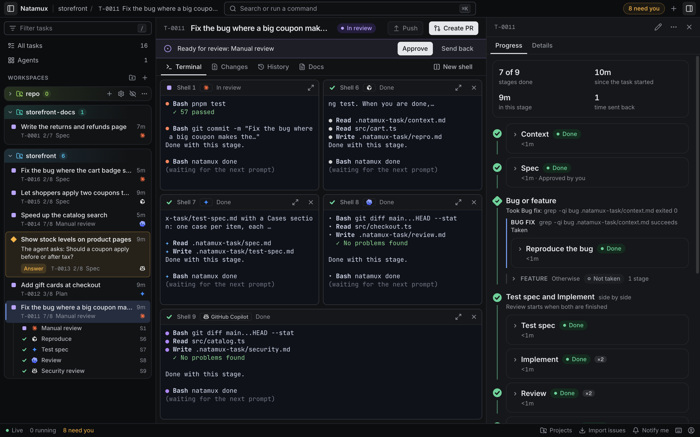
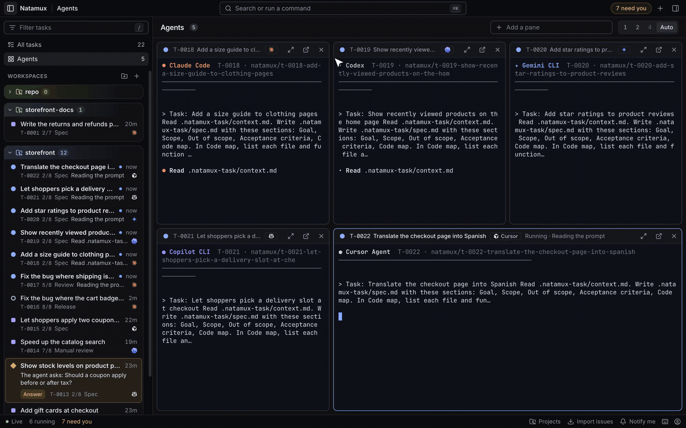
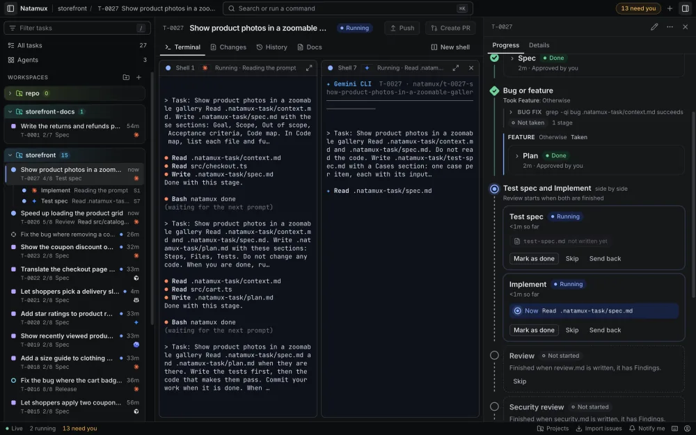
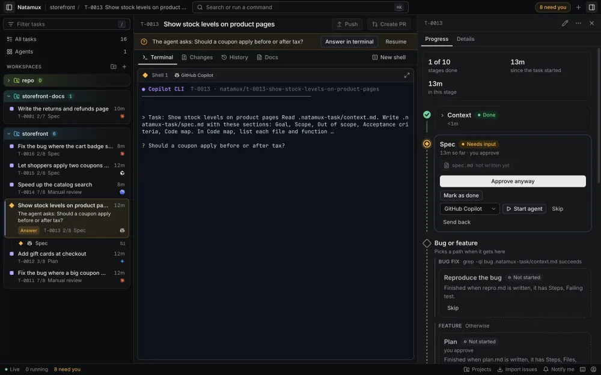
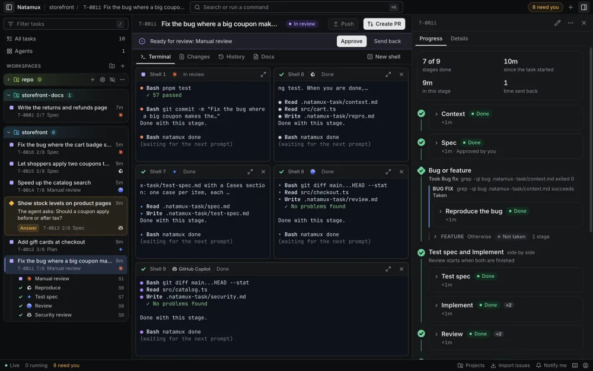
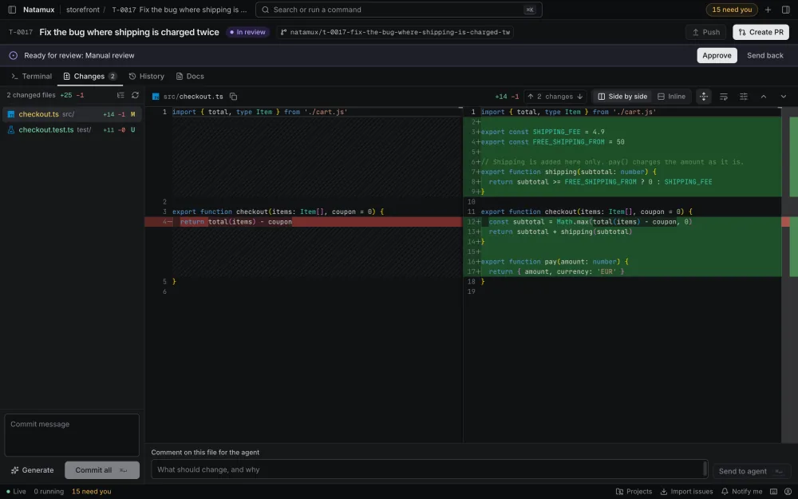
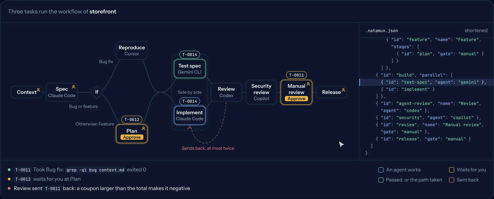

<p align="center">
  <a href="https://natamux.github.io/"></a>
</p>

<h1 align="center">Natamux</h1>

<p align="center">
  <b>Write your workflow once. Every task runs it, with the coding agents you pick.</b>
</p>

<p align="center">
  Stages, approvals, branches and send backs live in one committed file, <code>.natamux.json</code>.<br>
  <b>Solo:</b> approve the spec, and the rest runs without you.<br>
  <b>Team:</b> everyone shares one process, and each task takes the path that fits it.<br>
  Every task gets its own git worktree and terminal, each stage can use a different agent<br>
  (Claude Code, Codex, Gemini CLI, Copilot or Cursor), and one dashboard shows what needs you.
</p>

<p align="center">
  <a href="https://github.com/lenhatthanh20/natamux/releases/latest"><b>Download</b></a> ·
  <a href="https://natamux.github.io/docs/getting-started/install/">Install guide</a> ·
  <a href="https://natamux.github.io/docs/getting-started/quick-start/">Quick start</a> ·
  <a href="https://natamux.github.io/docs/">Documentation</a> ·
  <a href="https://codespaces.new/lenhatthanh20/natamux">Try in Codespaces</a>
</p>

<p align="center">
  <a href="https://github.com/lenhatthanh20/natamux/releases/latest"></a>
  <a href="https://github.com/lenhatthanh20/natamux/actions/workflows/ci.yml"></a>
  <a href="LICENSE"></a>
  <a href="https://natamux.github.io/docs/getting-started/install/"></a>
</p>

<picture>
  <source media="(prefers-color-scheme: dark)" srcset="site/public/screens/readme-workflow.png">
  <source media="(prefers-color-scheme: light)" srcset="site/public/screens/readme-workflow-light.png">
  
</picture>

<p align="center">
  <a href="https://natamux.github.io/#film">Watch one task go from bug report to your approval, in 39 seconds →</a>
</p>

## Why Natamux

Coding agents are good at one job at a time. Run five of them and you start to juggle:

- Terminal tabs, and no way to tell which agent works, which is stuck and which finished an hour ago.
- Two agents in one checkout, editing the same files.
- A question or a permission prompt that waits where nobody sees it.
- Work that nobody checked before it reaches a pull request.
- A team where each person runs agents their own way, with no shared process.

Natamux puts each task in its own worktree, so agents never share a checkout. It shows every agent's state on one dashboard and brings questions and permission prompts to you. It runs a review stage before the pull request, and it keeps the process in one file the team commits. You step in only where that workflow asks for you.

## Features

<picture>
  <source media="(prefers-color-scheme: dark)" srcset="site/public/screens/readme-agents-dark.gif">
  <source media="(prefers-color-scheme: light)" srcset="site/public/screens/readme-agents-light.gif">
  
</picture>

<p align="center"><sub>Recorded in the app. The agents' terminal output is scripted for the demo.</sub></p>

- **Agents that check each other.** Work is checked twice before it reaches you. In the default workflow, one agent writes test cases from the spec without reading the code while another writes the code, and a third agent reviews the diff in a fresh session and sends the task back to Implement when it finds problems.
- **A worktree, a branch and a terminal per task.** Each task works in its own folder on a branch such as `natamux/t-0001-fix-login`, so agents never edit the same checkout. Its shells keep running when you close the dashboard and come back with their screen.
- **One place for what needs you.** The title bar counts the tasks that wait for you: a question, a stage ready for review, a failure, or an agent quiet for 10 minutes. A question becomes a sidebar card with **Answer**. Turn on **Notify me** for system notifications.
- **One workflow for the whole team.** It lives in `.natamux.json`, so you commit it like code. Pick stages from a catalog of 28, choose which ones wait for your approval, run 2 to 4 stages side by side, split the pipeline into paths with a condition, and check a stage on CI.
- **An agent per stage.** Give each stage its own agent and model: Claude Code to implement, Cursor to review, Copilot to watch CI, each in its own shell.
- **Every task at a glance.** Switch between **Table**, **Board** and **Progress** views, open **Agents** for a grid of up to six live terminals, or press <kbd>Cmd</kbd>+<kbd>K</kbd> (<kbd>Ctrl</kbd>+<kbd>K</kbd> outside a terminal) or <kbd>F1</kbd> to find any task or command.
- **Review and ship from the task.** Read side-by-side or inline diffs, including image diffs. Send a line comment to the agent, let the agent draft the commit message, then commit, push and open a pull request. A merged pull request finishes the task.
- **Fits the project you already have.** A `.natamux-setup` script (`.natamux-setup.ps1` on Windows) prepares each new worktree. Each task gets ten ports, the first in `$PORT`, so dev servers do not clash.

<table>
<tr>
<td width="50%" valign="top">
<picture><source media="(prefers-color-scheme: dark)" srcset="site/public/media/v2/side-by-side-dark-1000.webp"><source media="(prefers-color-scheme: light)" srcset="site/public/media/v2/side-by-side-light-1000.webp"></picture>
<b>Side by side.</b> Two agents on one task, each in its own shell.
</td>
<td width="50%" valign="top">
<picture><source media="(prefers-color-scheme: dark)" srcset="site/public/media/v2/needs-you-dark-1000.webp"><source media="(prefers-color-scheme: light)" srcset="site/public/media/v2/needs-you-light-1000.webp"></picture>
<b>Needs you.</b> A question waits on a card, not in a hidden tab.
</td>
</tr>
<tr>
<td width="50%" valign="top">
<picture><source media="(prefers-color-scheme: dark)" srcset="site/public/media/v2/progress-took-dark-1000.webp"><source media="(prefers-color-scheme: light)" srcset="site/public/media/v2/progress-took-light-1000.webp"></picture>
<b>Paths and send back.</b> See which path a task took, and why.
</td>
<td width="50%" valign="top">
<picture><source media="(prefers-color-scheme: dark)" srcset="site/public/media/v2/changes-dark-1000.webp"><source media="(prefers-color-scheme: light)" srcset="site/public/media/v2/changes-light-1000.webp"></picture>
<b>Changes.</b> Diff, comment, commit and open the pull request.
</td>
</tr>
</table>

## How it works

Build the workflow in **Project settings → Stages**, or edit `.natamux.json` directly. Below, three tasks run the workflow of a sample project: a bug takes the **Bug fix** path, two agents work side by side, Codex reviews and sends one task back, and the last word is yours.

<picture>
  <source media="(prefers-color-scheme: dark)" srcset="site/public/screens/readme-workflow-dark.gif">
  <source media="(prefers-color-scheme: light)" srcset="site/public/screens/readme-workflow-light.gif">
  
</picture>

The animation shows a custom workflow. With no `.natamux.json`, a task runs the default stages: `Context → Spec → Plan → [ Test spec ‖ Implement ] → Automated tests → Review → Release`.

1. You approve the spec and the plan that the task's agent writes.
2. Test spec and Implement start together, each in its own shell. You approve the test spec.
3. Automated tests adds a test for each case and runs all tests.
4. The Review agent writes `review.md`. With findings, it sends the task back to Implement, at most two times; then it asks you.
5. Release waits for your pull request. The merge finishes the task.

A workflow branch takes the first path whose condition holds (**File has text** or **Command succeeds**), and a red CI run goes back to the agent with the end of the failed log. Start from a recipe, Solo or Team, in [Build a workflow](https://natamux.github.io/docs/guides/workflows/). See also [the review loop](https://natamux.github.io/docs/concepts/review-loop/) and [stages](https://natamux.github.io/docs/concepts/stages/).

## Works with your agents

Natamux starts the agent CLIs you already have and adds hooks, so the dashboard knows when an agent works, asks or finishes.

| Agent | Command | How Natamux follows it |
|---|---|---|
| Claude Code | `claude` | Hooks in a settings file passed with `--settings` for that run. The only agent that can run a stage as a workflow. |
| Codex | `codex` | Hooks passed on the command line for that run. |
| Gemini CLI | `gemini` | Hooks in a system settings file that Natamux points it to. |
| GitHub Copilot CLI | `copilot` | Hooks in the worktree, kept out of git. |
| Cursor | `cursor-agent` | Hooks in the worktree, kept out of git. |
| Any other terminal agent | yours | The terminal bell, plus `natamux ask` and `natamux done`. |

See [Mix agents in one task](https://natamux.github.io/docs/guides/mix-agents/) and [Agents and hooks](https://natamux.github.io/docs/concepts/agents-and-hooks/).

## Install

Download the file for your system from the [latest release](https://github.com/lenhatthanh20/natamux/releases/latest):

| System | Download |
|---|---|
| macOS, Apple silicon | [`Natamux-mac-arm64.dmg`](https://github.com/lenhatthanh20/natamux/releases/latest/download/Natamux-mac-arm64.dmg) |
| macOS, Intel | [`Natamux-mac-x64.dmg`](https://github.com/lenhatthanh20/natamux/releases/latest/download/Natamux-mac-x64.dmg) |
| Windows 10 and 11, x64 | [`Natamux-win-x64.exe`](https://github.com/lenhatthanh20/natamux/releases/latest/download/Natamux-win-x64.exe) |
| Linux, any distribution | [`Natamux-linux-x86_64.AppImage`](https://github.com/lenhatthanh20/natamux/releases/latest/download/Natamux-linux-x86_64.AppImage) |
| Debian and Ubuntu | [`Natamux-linux-amd64.deb`](https://github.com/lenhatthanh20/natamux/releases/latest/download/Natamux-linux-amd64.deb) |
| Linux, no install | [`Natamux-linux-x64.tar.gz`](https://github.com/lenhatthanh20/natamux/releases/latest/download/Natamux-linux-x64.tar.gz) |
| Native app (beta), macOS Apple silicon | [Native app releases](https://github.com/lenhatthanh20/natamux/releases?q=native-beta) |

> [!NOTE]
> The apps are not signed with an Apple or Windows certificate yet, so the system asks once. macOS: **System Settings → Privacy & Security → Open Anyway**. Windows: SmartScreen **More info → Run anyway**. Linux: `chmod +x` the AppImage first. Check any file against the signed `SHA256SUMS.txt` of the release.

Desktop releases support **macOS on Apple silicon** and Intel, **Windows** 10 (1809 or later) and 11 on x64, and **Linux** on x64. The macOS app (installed in Applications), the AppImage and the .deb can update themselves; the Windows installer and the .tar.gz open the release page of the new version. The update check is off until you turn it on.

For real work, you need git and an installed, logged-in coding agent: Claude Code, Codex, Gemini CLI, GitHub Copilot CLI or Cursor. The GitHub CLI (`gh`) is optional, for pull requests, issues and CI. The [install guide](https://natamux.github.io/docs/getting-started/install/) has every step.

## Quick start

1. **Add a project.** Choose **File → Add Project…** and pick a git repository.
2. **Start a task.** Press `c`, type a title and notes, pick the agent, and click **Start task**. Natamux makes a worktree and a branch and starts the agent in the task's terminal.
3. **Approve the spec, the plan and the test spec** when the task asks. The rest runs by itself.
4. **Read the changes** in the **Changes** tab, click **Generate** for a commit message, then **Commit all**, **Push** and **Create PR**.

The [quick start](https://natamux.github.io/docs/getting-started/quick-start/) walks through it with screenshots.

### Try the demo in Codespaces

No install needed. [Open this repository in GitHub Codespaces](https://codespaces.new/lenhatthanh20/natamux), then run:

```sh
scripts/dev.sh demo
```

Open forwarded port **5173** and sign in with the token **`devtoken`**. The demo includes a task with a workspace, commits and changes to inspect.

To see tasks in every state, run `scripts/dev.sh seed`. It starts fake agents through `scripts/fake-agent.sh`; the development Docker images do not include a real coding agent. Run `scripts/dev.sh up` to return to the normal development setup. See [Docker setup](docs/docker.md) for details.

## Command line

`natamux`, short name `nmx`, works in every task terminal and from your own shell.

| Command | What it does |
|---|---|
| `nmx task create "Fix the login" --label bug` | Add a task to the backlog |
| `nmx agent start T-0001 --agent codex` | Start an agent in the task's own worktree |
| `nmx stage approve T-0001` | Approve the stage that waits |
| `nmx stage back T-0001 --reason "..."` | Send the task back to an earlier stage |
| `natamux ask "Which API?"` / `natamux done` | What agents run to ask you, or to finish a stage |

See the [CLI reference](https://natamux.github.io/docs/reference/cli/) and [CLI usage](packages/cli/README.md).

## Security and privacy

- **No account or telemetry.** Natamux has no server of its own. Tasks and their history stay in the `.natamux/` folder of each repository.
- **Local daemon.** It listens on 127.0.0.1 and wants a token on every request. In Docker it listens inside the container, and the production compose file publishes the port to loopback only.
- **Your services, your sign-in.** Coding agents send your prompts and code to their own providers. Pull requests, issues and CI use your own `git` and `gh` login.
- **Checked updates.** The update check is off by default. Before it installs an update, the app checks the minisign signature of the release's `SHA256SUMS.txt` and the SHA-256 of the download.

> [!IMPORTANT]
> Natamux does not sandbox agents: an agent has your user's rights. By default Natamux starts each agent with its flag for fewer prompts: Claude Code in auto mode, which checks each action, and the other agents with prompts off (Codex stays in its workspace-write sandbox). Set `"agents": { "permissionMode": "ask" }` in `.natamux.json` to turn the flags off.

Read [Privacy](PRIVACY.md) for what stays on your machine and what leaves it, and [Security](SECURITY.md) for protection details and private vulnerability reporting.

## Repository guide

| Path | Purpose |
| --- | --- |
| [`packages/core`](packages/core/) | Task model, stages, events and shared schemas |
| [`packages/daemon`](packages/daemon/) | Tasks, stages, git worktrees, terminals, and the HTTP/WebSocket API |
| [`packages/web`](packages/web/) | React dashboard |
| [`packages/desktop`](packages/desktop/) | Desktop app and bundled daemon |
| [`packages/cli`](packages/cli/) | `natamux` / `nmx` command line |
| [`plugins/natamux`](plugins/natamux/) | Claude Code plugin |
| [`site`](site/) | Homepage and documentation site |

The [documentation site](https://natamux.github.io/docs/) covers tasks, stages, agents, the dashboard, the desktop app and every setting. To run the daemon and dashboard on a server, see [Docker setup](docs/docker.md#production).

## Contributing

Natamux is young and moves fast. Issues and pull requests are welcome.

- Set up with the [contributor setup](docs/dev-setup.md). Development runs in a GitHub codespace.
- Every pull request runs the build, lint and tests, a dependency audit, a Docker smoke test, and Playwright end-to-end tests against the production images. Each push to `main` also runs the tests on Node 24, macOS and Windows, and starts the desktop app on macOS and Windows.
- Report a vulnerability privately, as [Security](SECURITY.md) describes. Do not open a public issue for it.

## License

[MIT](LICENSE)
