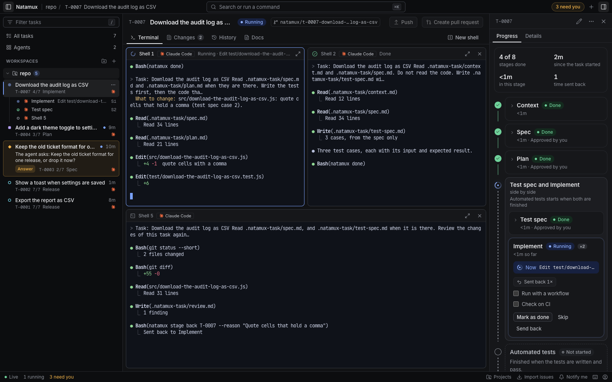

# Natamux

**Run coding agents in parallel. Let them check each other's work. See what needs you on one dashboard.**

Natamux is an open-source Agent Development Environment. Each task gets its own git worktree, branch and terminal, so agents work side by side without touching the same files. Two agents build a task while a third reviews it, and one dashboard shows what every task is doing.

[Download](https://github.com/lenhatthanh20/natamux/releases/latest) · [Install guide](https://natamux.github.io/docs/getting-started/install/) · [Quick start](https://natamux.github.io/docs/getting-started/quick-start/) · [Documentation](https://natamux.github.io/docs/) · [Try in Codespaces](https://codespaces.new/lenhatthanh20/natamux)



## Get started

### Install the desktop app

1. Download the file for your system from the [latest release](https://github.com/lenhatthanh20/natamux/releases/latest):

   | System | Download |
   |---|---|
   | macOS, Apple silicon | [`Natamux-mac-arm64.dmg`](https://github.com/lenhatthanh20/natamux/releases/latest/download/Natamux-mac-arm64.dmg) |
   | macOS, Intel | [`Natamux-mac-x64.dmg`](https://github.com/lenhatthanh20/natamux/releases/latest/download/Natamux-mac-x64.dmg) |
   | Windows 10 and 11, x64 | [`Natamux-win-x64.exe`](https://github.com/lenhatthanh20/natamux/releases/latest/download/Natamux-win-x64.exe) |
   | Linux, any distribution | [`Natamux-linux-x86_64.AppImage`](https://github.com/lenhatthanh20/natamux/releases/latest/download/Natamux-linux-x86_64.AppImage) |
   | Debian and Ubuntu | [`Natamux-linux-amd64.deb`](https://github.com/lenhatthanh20/natamux/releases/latest/download/Natamux-linux-amd64.deb) |
   | Linux, no install | [`Natamux-linux-x64.tar.gz`](https://github.com/lenhatthanh20/natamux/releases/latest/download/Natamux-linux-x64.tar.gz) |

2. Open it. The apps are not signed yet, so the system asks once. macOS: **System Settings → Privacy & Security → Open Anyway**. Windows: SmartScreen **More info → Run anyway**. Linux: `chmod +x` the AppImage first. Check any file against `SHA256SUMS.txt` of the release. The [install guide](https://natamux.github.io/docs/getting-started/install/) has every step.

Desktop releases support **macOS on Apple silicon** and Intel, **Windows** 10 (1809 or later) and 11 on x64, and **Linux** on x64. The macOS and Linux apps update themselves; on Windows the app opens the release page of the new version. For real work, you need git and an installed, logged-in coding agent: Claude Code, Codex, Gemini CLI, GitHub Copilot CLI or Cursor. The GitHub CLI (`gh`) is optional, for pull requests, issues and CI.

### Run your first task

1. **Add a project.** Choose **File → Add Project…** and pick a git repository.
2. **Start a task.** Press `c`, type a title and notes, pick the agent, and click **Start task**. Natamux makes a worktree and a branch and starts the agent in the task's terminal.
3. **Approve the spec, the plan and the test spec** when the task asks. The rest runs by itself.
4. **Read the changes** in the **Changes** tab, click **Generate** for a commit message, then **Commit all**, **Push** and **Create pull request**.

The [quick start](https://natamux.github.io/docs/getting-started/quick-start/) walks through it with screenshots.

### Explore the demo in Codespaces

[Open this repository in GitHub Codespaces](https://codespaces.new/lenhatthanh20/natamux), then run:

```sh
scripts/dev.sh demo
```

Open forwarded port **5173** and sign in with the token **`devtoken`**. The demo includes a task with a workspace, commits and changes to inspect.

To see tasks in every state, run `scripts/dev.sh seed`. It starts fake agents through `scripts/fake-agent.sh`; the development Docker images do not include a real coding agent. Run `scripts/dev.sh up` to return to the normal development setup. See [Docker setup](docs/docker.md) for details.

## What you can do

- **Let agents check each other.** After you approve the plan, one agent writes the test cases from the spec while another writes the code. A third agent, in its own shell and session, reviews the changes and sends the task back to Implement when it finds problems.
- **Keep work separate.** Each task has a git worktree, branch and terminal that keeps running when you close the dashboard. Agents never edit the same checkout.
- **See what needs you.** A question, a failure or a stage that waits for review becomes a card in the sidebar, and the title bar counts every task that needs you. Turn on system notifications with **Notify me**.
- **Watch every agent.** Switch the task list between table, board and progress views, or open **Agents** for a grid of up to six live agent terminals.
- **Shape the pipeline.** Pick stages from a catalog of 28, run stages side by side, choose which ones wait for your approval, give a stage its own agent or model, check a stage on CI, or run it as a Claude Code workflow. The settings live in `.natamux.json`.
- **Review and deliver.** Read side-by-side diffs, send a comment on a line to the agent, let the agent draft the commit message, then commit, push and open a pull request. A merged pull request finishes the task.
- **Use your own agent.** Natamux starts Claude Code, Codex, Gemini CLI, GitHub Copilot CLI or Cursor, and adds hooks so the dashboard knows when an agent works, asks or finishes.

### How a task flows

The default stages are `Context → Spec → Plan → [ Test spec ‖ Implement ] → Automated tests → Review → Release`.

1. You approve the spec and the plan that the task's agent writes.
2. Test spec and Implement start together, in Shell 2 and Shell 1. You approve the test spec.
3. Automated tests adds a test for each case and runs all tests.
4. The Review agent writes `review.md`. With findings, it sends the task back to Implement, at most two times; then it asks you.
5. Release waits for your pull request. The merge finishes the task.

Choose the review agent per project in **Settings → Stages → Review → Agent**. See [the review loop](https://natamux.github.io/docs/concepts/review-loop/).

### Command line

`natamux`, short name `nmx`, works in every task terminal and from your own shell.

| Command | What it does |
|---|---|
| `nmx task create "Fix the login" --label bug` | Add a task to the backlog |
| `nmx agent start T-0001 --agent codex` | Start an agent in the task's own worktree |
| `nmx stage approve T-0001` | Approve the stage that waits |
| `nmx stage back T-0001 --reason "..."` | Send the task back to an earlier stage |
| `natamux ask "Which API?"` / `natamux done` | What agents run to ask you, or to finish a stage |

See the [CLI reference](https://natamux.github.io/docs/reference/cli/) and [CLI usage](packages/cli/README.md).

## Repository guide

| Path | Purpose |
| --- | --- |
| [`packages/core`](packages/core/) | Task model, stages, events and shared schemas |
| [`packages/daemon`](packages/daemon/) | Tasks, stages, git worktrees, terminals, and the HTTP/WebSocket API |
| [`packages/web`](packages/web/) | React dashboard |
| [`packages/desktop`](packages/desktop/) | Desktop app and bundled daemon |
| [`packages/cli`](packages/cli/) | `natamux` / `nmx` command line |
| [`plugins/natamux`](plugins/natamux/) | Claude Code plugin |
| [`site`](site/) | Homepage and documentation site |

For development, see the [contributor setup](docs/dev-setup.md) and the [Docker guide](docs/docker.md). The [documentation site](https://natamux.github.io/docs/) covers tasks, stages, agents, the dashboard, the desktop app and every setting.

## Security and privacy

Natamux has no account or telemetry. The desktop app checks GitHub for new releases; coding agents and GitHub actions use their own services and credentials. Read [Privacy](PRIVACY.md) for what stays on your machine and what leaves it, and [Security](SECURITY.md) for protection details and private vulnerability reporting.

## License

[MIT](LICENSE)
