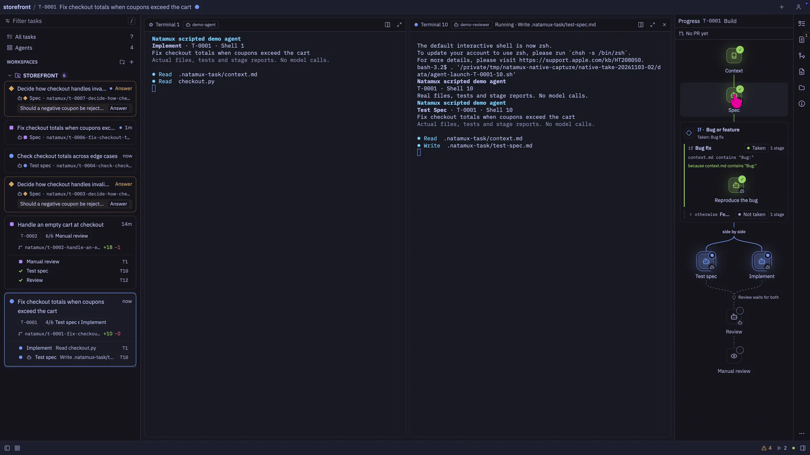
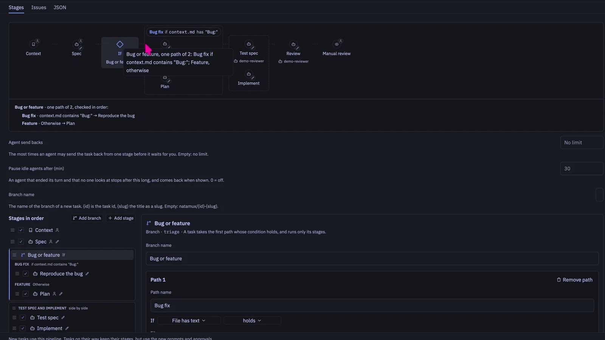
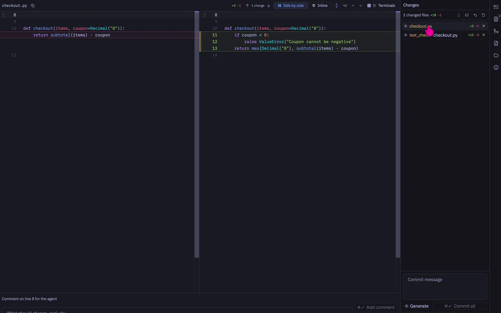
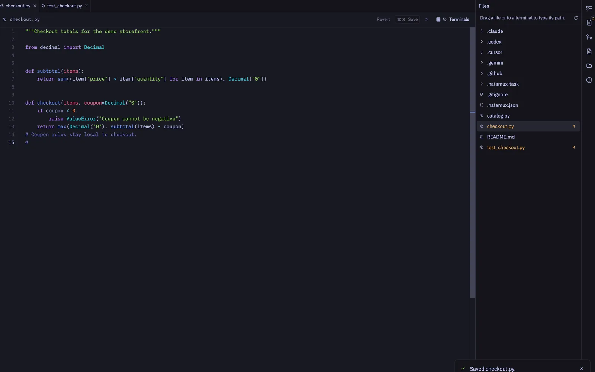
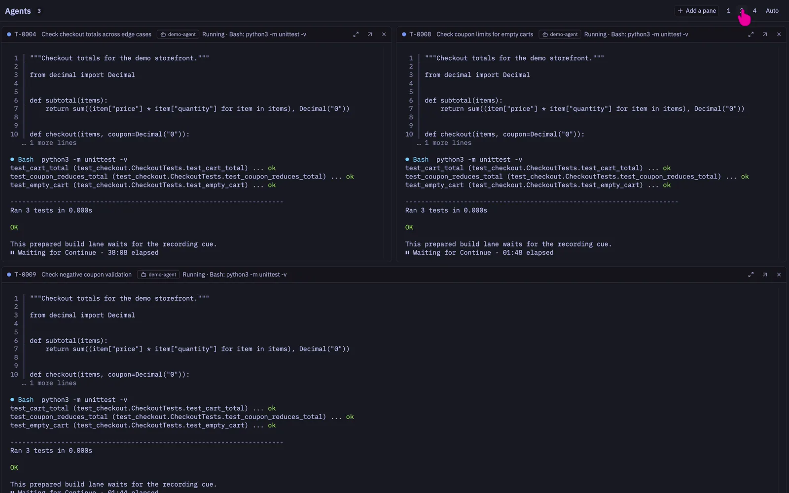

<p align="center">
  <a href="https://natamux.github.io/"></a>
</p>

<h1 align="center">Natamux</h1>

<p align="center"><b>One workflow for every coding task.</b></p>

<p align="center">
  Run coding agents in isolated worktrees, follow their progress in one dashboard, and review every change before it ships.
</p>

<p align="center">
  <a href="https://github.com/lenhatthanh20/natamux/releases/latest">Download</a> ·
  <a href="https://natamux.github.io/docs/getting-started/quick-start/">Quick start</a> ·
  <a href="https://natamux.github.io/docs/">Documentation</a> ·
  <a href="https://natamux.github.io/#film">See it in action</a>
</p>

<p align="center">
  <a href="https://github.com/lenhatthanh20/natamux/releases/latest"></a>
  <a href="https://github.com/lenhatthanh20/natamux/actions/workflows/rust.yml"></a>
  <a href="LICENSE"></a>
</p>

<p align="center">
  <picture>
    <source media="(prefers-color-scheme: light)" srcset="site/public/media/native/hero-light.webp">
    
  </picture>
</p>

## What it does

Natamux gives each task its own git worktree, branch, and terminal. A shared workflow in `.natamux.json` assigns agents to stages, runs independent work in parallel, and pauses for approvals when needed. The dashboard brings tasks, live terminals, questions, and diffs together.

- **Keep work isolated.** Agents on different tasks never edit the same checkout.
- **Coordinate agents.** Use Claude Code, Codex, Gemini CLI, GitHub Copilot CLI, Cursor, or another terminal agent.
- **Make progress visible.** Track stages and terminals, and see what needs your attention.
- **Review before shipping.** Inspect diffs, send feedback, commit, push, and open a pull request from the task.
- **Share the process.** Commit `.natamux.json` so the team uses the same workflow.

<table>
  <tr>
    <td width="50%" valign="top">
      <picture><source media="(prefers-color-scheme: light)" srcset="site/public/media/native/settings-light.webp"></picture>
      <b>Design the workflow.</b> Arrange stages, branches, and approvals.
    </td>
    <td width="50%" valign="top">
      <picture><source media="(prefers-color-scheme: light)" srcset="site/public/media/native/review-light.webp"></picture>
      <b>Review changes.</b> Inspect the diff and respond before shipping.
    </td>
  </tr>
  <tr>
    <td width="50%" valign="top">
      <picture><source media="(prefers-color-scheme: light)" srcset="site/public/media/native/editor-light.webp"></picture>
      <b>Work in context.</b> Edit project files beside the task and its terminals.
    </td>
    <td width="50%" valign="top">
      <picture><source media="(prefers-color-scheme: light)" srcset="site/public/media/native/agents-light.webp"></picture>
      <b>Follow every agent.</b> See each terminal and stage in one view.
    </td>
  </tr>
</table>

## Get started

Install the latest release:

```sh
curl -fsSL https://natamux.github.io/install.sh | sh
```

On Windows, use PowerShell:

```powershell
irm https://natamux.github.io/install.ps1 | iex
```

Then add a git project, create a task, and choose an agent. Natamux creates its worktree and starts the task workflow. You need git and an installed, signed-in coding agent. See the [install guide](https://natamux.github.io/docs/getting-started/install/) for supported systems and setup details.

## Workflow

Start with the default stages or define your own in `.natamux.json`. A workflow can run stages side by side, route tasks by conditions, and send changes back for another review.

```text
Context → Spec → Implement → Review → Release
```

Learn how to [build a workflow](https://natamux.github.io/docs/guides/workflows/) or [start a task](https://natamux.github.io/docs/getting-started/quick-start/).

## Privacy

Natamux has no account or telemetry. Task data stays in each repository's `.natamux/` folder. Agents connect to their own providers using your sign-in. Natamux does not sandbox agents; review the [security notes](SECURITY.md) before use.

## Project

- [Documentation](https://natamux.github.io/docs/)
- [Contributing](docs/dev-setup.md)
- [Security](SECURITY.md)
- [License](LICENSE) · GPL-3.0-or-later
