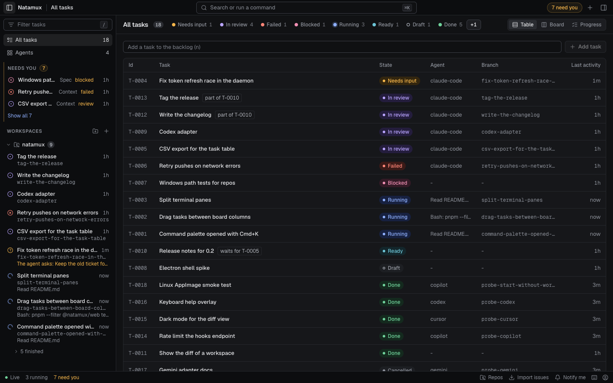

# Natamux

**Run coding agents in parallel. See what needs you on one dashboard.**

Natamux is an open-source Agent Development Environment. Each task gets its own git worktree and terminal, so agents can work side by side while you follow their progress in one place.

[Download for macOS (Apple silicon)](https://github.com/lenhatthanh20/natamux/releases/latest) · [Install guide](https://natamux.github.io/docs/getting-started/install/) · [Quick start](https://natamux.github.io/docs/getting-started/quick-start/) · [Try in Codespaces](https://codespaces.new/lenhatthanh20/natamux)



## Get started

### Install the desktop app

1. Download the latest `Natamux-mac-arm64.dmg` from [Releases](https://github.com/lenhatthanh20/natamux/releases/latest).
2. Install and open Natamux. The app is currently unsigned; the [install guide](https://natamux.github.io/docs/getting-started/install/) covers the first-open steps.
3. Add a git repository, create a task, and start an agent. Follow the [quick start](https://natamux.github.io/docs/getting-started/quick-start/) for a complete walkthrough.

Current desktop releases support **macOS on Apple silicon**. Intel Mac and Linux builds are paused; there is no Windows release yet. For real work, you need git and an installed, logged-in coding agent such as Claude Code, Codex, Gemini CLI, GitHub Copilot CLI, or Cursor. The GitHub CLI (`gh`) is optional for issues, pull requests, and CI status.

### Explore the demo in Codespaces

[Open this repository in GitHub Codespaces](https://codespaces.new/lenhatthanh20/natamux), then run:

```sh
scripts/dev.sh demo
```

Open forwarded port **5173** and sign in with the token **`devtoken`**. The demo includes a task with a workspace, commits, and changes to inspect.

To see tasks in different states with agents at work, run `scripts/dev.sh seed`. It starts fake agents through `scripts/fake-agent.sh`; the development Docker images do not include a real coding agent. Run `scripts/dev.sh up` to return to the normal development setup. See [Docker setup](docs/docker.md) for details.

## What you can do

- **Keep work separate.** Each task has a git worktree, branch, and terminal that keeps running when you close the dashboard. Run several tasks without agents editing the same checkout.
- **See what needs you.** The **Needs you** queue highlights questions, reviews, blocked work, and failures. Switch between table, board, and progress views.
- **Use your own agent.** Natamux starts Claude Code, Codex, Gemini CLI, GitHub Copilot CLI, or Cursor in a task terminal. Hooks report when an agent is working or waiting for input.
- **Guide each task through stages.** The default flow is Context → Spec → Plan → Test spec and Implement → Review → Testing → Release. Configure stages and approval gates per repository. [How stages work](docs/design-task-stages.md).
- **Review and deliver.** Inspect file diffs and branch history, send review comments back to the agent, then commit, push, and open a pull request from the dashboard.

## Repository guide

| Path | Purpose |
| --- | --- |
| [`packages/core`](packages/core/) | Task model, events, and shared schemas |
| [`packages/daemon`](packages/daemon/) | Tasks, stages, git worktrees, terminals, and HTTP/WebSocket API |
| [`packages/web`](packages/web/) | React dashboard |
| [`packages/desktop`](packages/desktop/) | Desktop app and bundled daemon |
| [`packages/cli`](packages/cli/) | `natamux` / `nmx` command line |
| [`plugins/natamux`](plugins/natamux/) | Claude Code plugin |

For development, see the [contributor setup](docs/dev-setup.md), [Docker guide](docs/docker.md), and [CLI usage](packages/cli/README.md). The [documentation site](https://natamux.github.io/docs/) covers tasks, agents, stages, and the desktop app.

## Security and privacy

Natamux has no account or telemetry. Coding agents and GitHub actions use their own services and credentials. Read [Privacy](PRIVACY.md) for what stays on your machine and what leaves it, and [Security](SECURITY.md) for protection details and private vulnerability reporting.

## License

[MIT](LICENSE)
