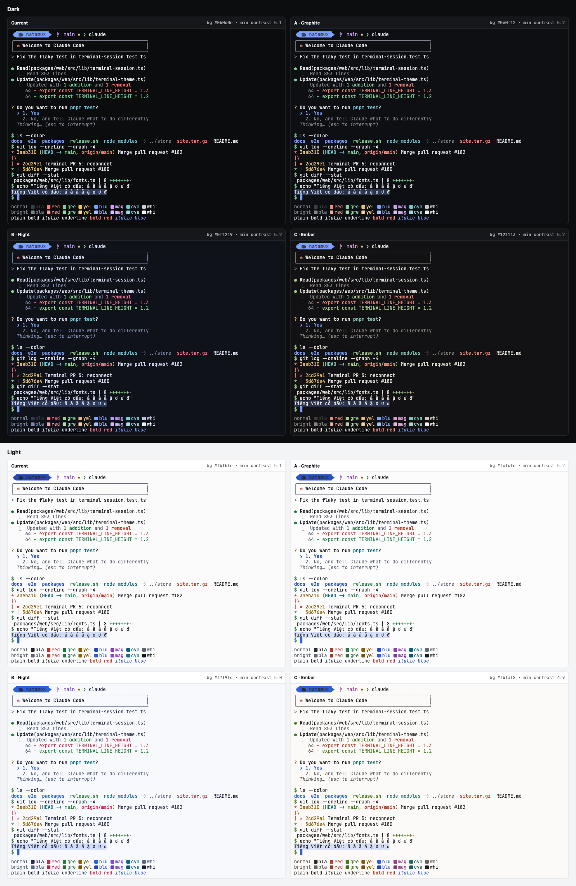

# Design: terminal look (T-0005)

Status: built 2026-10-12. Palette "Night" picked by the owner.

## Goal

The terminal pane looks and feels like a top native terminal (Ghostty, iTerm2, VS Code, JetBrains), with no cost in speed.

## What other terminals do

| Topic | Common practice | Examples |
|---|---|---|
| Font | JetBrains Mono is the most common default. Ghostty also bundles Nerd Font icons | Ghostty, WezTerm, JetBrains IDEs: JetBrains Mono. Windows Terminal: Cascadia Mono. Warp: Hack. Zed: Lilex |
| Cell | 12 to 14 px, line height 1.0 to 1.2 | Ghostty 13 (macOS), Warp 1.2 |
| Ligatures | Off, and they cost drawing time | VS Code, Warp. iTerm2 drops its GPU path with them |
| Cursor | Block. Hollow or outline when unfocused | VS Code `cursorStyleInactive: outline` |
| Padding | Small, the same on all sides | Ghostty 2 px, Windows Terminal 8 px |
| Unfocused split | Dimmed about 30% | Ghostty `unfocused-split-opacity` 0.7, iTerm2 "Dim inactive panes" |
| Contrast | Minimum contrast 4.5 (VS Code) or off (Ghostty) | |
| Fast scroll | Alt + wheel, 5× | VS Code `fastScrollSensitivity` |

Sources: ghostty.org/docs/config/reference, code.visualstudio.com/docs/terminal/appearance, learn.microsoft.com/windows/terminal/customize-settings/profile-appearance, wezterm.org/config/lua/config/window_padding.html, iterm2.com/documentation-preferences-appearance.html, docs.warp.dev/appearance/text-fonts-cursor, zed.dev/docs/reference/all-settings.

## Decisions

| Part | Before | After | Where |
|---|---|---|---|
| Font | Geist Mono 13 px | JetBrains Mono 13 px (`@fontsource-variable/jetbrains-mono`, normal and italic). The rest of the UI and Monaco keep Geist Mono | `lib/fonts.ts` `TERMINAL_FONT`, `main.tsx` |
| Icons | Empty boxes without a Nerd Font | Bundled Symbols Nerd Font Mono v3.4.0, right after the main font, also behind a font the user picks | `src/assets/fonts/`, `@font-face` in `styles.css` |
| Line height | 1.3 | 1.2 | `TERMINAL_LOOK` in `lib/terminal-theme.ts` |
| Bold | Bright color, weight 700 | Own color, weight 600 | `TERMINAL_LOOK` |
| Cursor | Block, blinks | Block, blinks while focused, outline when unfocused | `TERMINAL_LOOK` |
| Fast scroll | xterm default | Alt + wheel 5× (set on purpose) | `TERMINAL_LOOK` |
| Padding | 8 top/bottom, 10 left, 0 right | 8 top/bottom, 10 left, 2 right. xterm keeps 8 px for its scrollbar, so text has 10 px on both sides and the scrollbar sits in the right padding | `TerminalView.tsx` |
| Unfocused panes | Same as the focused one | With two or more panes, the others get a dim layer (`--terminal` at 0.3). No animation. Clicks go through | `.hm-panes` / `.hm-pane` in `styles.css` |
| Selection | One color | Dimmer color when the terminal does not have the focus | `selectionInactiveBackground` |
| Colors | See "Current" below | "Night" | `lib/terminal-theme.ts`, `--terminal` in `styles.css` |

### Icon font

- No well-known npm package ships it, so the file is vendored unchanged from the official release (MIT, license next to it). Ghostty pins the same version.
- The Mono variant keeps each icon in one cell.
- `unicode-range` holds only the icon code points: both Private Use Areas, plus the few code points the font has outside them (read from its `cmap`). U+26A1 is left out: it is an emoji, two cells wide. So the browser downloads the file only when an icon is drawn.
- The GPU renderer caches a glyph before the font arrives, as an empty box. The session clears the texture atlas when `document.fonts` reports the icon font loaded.
- The file is a 2.5 MB TTF. A woff2 would be about 1 MB, but the conversion needs a tool that cannot run on the local machine. See open items.

## Palettes

Four designs, dark and light. All are Natamux's own; popular themes were ideas only. Each keeps the app's blue accent (`#7aa2ff` dark, `#2f5fe0` light). Ratios are contrast against the background; every named color except dark `black` is at least 4.5.

The demo screen shows a Claude Code style session, `ls --color`, `git log --graph`, `git diff --stat`, Vietnamese text with a selection, and the 16 colors. The browser drew `->` as an arrow there; xterm draws no ligatures.

To switch to another palette later, copy its values into `DARK` and `LIGHT` in `packages/web/src/lib/terminal-theme.ts`, set `--terminal` in `packages/web/src/styles.css` (both themes) to its background, and update the table in `docs/ui-spec.md`.

### Current (before this change)
| | Dark (on `#0b0c0e`) | Light (on `#fbfbfc`) |
|---|---|---|
| background / foreground | `#0b0c0e` / `#e6e7ea` (15.8) | `#fbfbfc` / `#17191d` (17.0) |
| cursor / cursorAccent | `#7aa2ff` / `#0b0c0e` | `#2f5fe0` / `#fbfbfc` |
| selectionBackground / selectionInactiveBackground | `#7aa2ff4d` / `#7aa2ff26` | `#2f5fe033` / `#2f5fe01a` |
| black / brightBlack | `#3a3f4b` (1.9) / `#7d828c` (5.1) | `#24272d` (14.5) / `#5f6570` (5.7) |
| red / brightRed | `#ff7b72` (7.8) / `#ffa198` (10.1) | `#c0362c` (5.3) / `#b93a30` (5.5) |
| green / brightGreen | `#6fd19a` (10.5) / `#8fe0b0` (12.5) | `#1c7442` (5.6) / `#237a48` (5.1) |
| yellow / brightYellow | `#e8c15a` (11.4) / `#f5d47a` (13.6) | `#8a5a00` (5.7) / `#8f6000` (5.3) |
| blue / brightBlue | `#7aa2ff` (7.9) / `#a5c0ff` (10.8) | `#2448b8` (7.5) / `#2f5fe0` (5.3) |
| magenta / brightMagenta | `#d09bff` (9.1) / `#e2bcff` (12.0) | `#8a3fb8` (5.8) / `#8f45c2` (5.3) |
| cyan / brightCyan | `#6cc4d6` (9.8) / `#97dbe8` (12.7) | `#0b6274` (6.7) / `#0f7489` (5.2) |
| white / brightWhite | `#c9ccd2` (12.2) / `#f2f3f5` (17.6) | `#5f6570` (5.7) / `#17191d` (17.0) |

### A · Graphite
| | Dark (on `#0e0f12`) | Light (on `#fcfcfd`) |
|---|---|---|
| background / foreground | `#0e0f12` / `#dcdfe4` (14.3) | `#fcfcfd` / `#1d2025` (15.9) |
| cursor / cursorAccent | `#7aa2ff` / `#0e0f12` | `#2f5fe0` / `#fcfcfd` |
| selectionBackground / selectionInactiveBackground | `#7aa2ff40` / `#7aa2ff1f` | `#2f5fe02e` / `#2f5fe017` |
| black / brightBlack | `#3b3f47` (1.8) / `#80858f` (5.2) | `#2a2d33` (13.5) / `#626874` (5.5) |
| red / brightRed | `#f2877f` (7.8) / `#f7a8a2` (10.1) | `#b83a30` (5.6) / `#a8352c` (6.4) |
| green / brightGreen | `#7fcf9a` (10.3) / `#9fdcb2` (12.2) | `#1f7a45` (5.2) / `#22703f` (5.9) |
| yellow / brightYellow | `#e2c27a` (11.2) / `#eed39a` (13.2) | `#8a5d00` (5.6) / `#7a5200` (6.7) |
| blue / brightBlue | `#7aa2ff` (7.7) / `#a3bdff` (10.3) | `#2850c8` (6.7) / `#2f5fe0` (5.3) |
| magenta / brightMagenta | `#c79cf2` (8.6) / `#dbbcf7` (11.5) | `#8c3fb5` (5.9) / `#7d35a6` (7.0) |
| cyan / brightCyan | `#72c3cf` (9.5) / `#9bd6df` (11.9) | `#0a6577` (6.5) / `#0b5a6a` (7.6) |
| white / brightWhite | `#c3c7ce` (11.3) / `#eef0f3` (16.8) | `#626874` (5.5) / `#1d2025` (15.9) |

### B · Night (picked)
| | Dark (on `#0f1219`) | Light (on `#f7f9fd`) |
|---|---|---|
| background / foreground | `#0f1219` / `#d6dcf0` (13.7) | `#f7f9fd` / `#1b2238` (15.0) |
| cursor / cursorAccent | `#7aa2ff` / `#0f1219` | `#2f5fe0` / `#f7f9fd` |
| selectionBackground / selectionInactiveBackground | `#7aa2ff47` / `#7aa2ff21` | `#2f5fe030` / `#2f5fe018` |
| black / brightBlack | `#343b52` (1.7) / `#7c86a8` (5.2) | `#262d45` (12.9) / `#5d6684` (5.4) |
| red / brightRed | `#f7768e` (7.1) / `#ff9bae` (9.4) | `#c4304f` (5.1) / `#b02a46` (6.1) |
| green / brightGreen | `#8fd694` (10.9) / `#aee6b2` (13.2) | `#2c7a3a` (5.0) / `#256c33` (6.1) |
| yellow / brightYellow | `#e6c07b` (10.9) / `#f0d39d` (12.9) | `#8c5f00` (5.3) / `#7b5300` (6.5) |
| blue / brightBlue | `#7aa2ff` (7.5) / `#a6c1ff` (10.4) | `#2f5fe0` (5.2) / `#2448b8` (7.4) |
| magenta / brightMagenta | `#bb9af7` (8.1) / `#d2bbfa` (10.9) | `#7c4dd6` (5.1) / `#6a3ec2` (6.5) |
| cyan / brightCyan | `#6fd0e0` (10.5) / `#9ce0eb` (12.7) | `#0b6a80` (5.9) / `#095c6f` (7.2) |
| white / brightWhite | `#b8c0dc` (10.4) / `#e8ecf8` (15.9) | `#5d6684` (5.4) / `#1b2238` (15.0) |

### C · Ember
| | Dark (on `#121113`) | Light (on `#fbfaf8`) |
|---|---|---|
| background / foreground | `#121113` / `#e4e0da` (14.3) | `#fbfaf8` / `#221f1c` (15.7) |
| cursor / cursorAccent | `#7aa2ff` / `#121113` | `#2f5fe0` / `#fbfaf8` |
| selectionBackground / selectionInactiveBackground | `#7aa2ff40` / `#7aa2ff1f` | `#2f5fe02e` / `#2f5fe017` |
| black / brightBlack | `#3d3a38` (1.7) / `#8a8580` (5.2) | `#2e2a27` (13.6) / `#6a645e` (5.6) |
| red / brightRed | `#ee8a7a` (7.7) / `#f4a99c` (9.9) | `#b4412f` (5.4) / `#a03a2a` (6.4) |
| green / brightGreen | `#a3c98a` (10.1) / `#bcd9a8` (12.2) | `#4a7a1f` (4.9) / `#406b1a` (6.0) |
| yellow / brightYellow | `#e7bf6e` (10.8) / `#f0d293` (12.9) | `#8a5a00` (5.7) / `#784e00` (7.0) |
| blue / brightBlue | `#7aa2ff` (7.6) / `#a3bdff` (10.1) | `#2f5fe0` (5.3) / `#2448b8` (7.5) |
| magenta / brightMagenta | `#d79bd0` (8.5) / `#e5b9e0` (11.1) | `#9a3f8f` (5.8) / `#87367d` (7.1) |
| cyan / brightCyan | `#84c4b6` (9.5) / `#a6d6cb` (11.7) | `#1f6f62` (5.7) / `#1a6055` (7.1) |
| white / brightWhite | `#c9c4bd` (10.9) / `#f3f0eb` (16.6) | `#6a645e` (5.6) / `#221f1c` (15.7) |

Why Night: it differs the most from before, the navy background suits the blue accent and the cursor, and red, green and magenta stay far apart, so diffs and logs read well. Graphite fits the gray UI best but looks almost the same as before. Ember is warm and soft, but its olive green makes `+` lines in diffs stand out less.

Claude Code draws most of its own UI in RGB colors, so the palette changes mostly shell output (prompts, `ls`, `git`).

## Speed

- WebGL stays the renderer, with the DOM fallback.
- No ligatures addon, `allowTransparency` off, `smoothScrollDuration` 0. A test keeps them out.
- The dim layer is one static element per unfocused pane, drawn by the compositor. Focus changes cause no resize. The selector uses `:focus-within` on the grid, not `:has()`, which the browser may check again for each row xterm writes.
- The icon font loads once, only when an icon shows. Clearing the atlas happens once per load.
- `e2e/tests/terminal-measures.spec.ts` records the output and key measures in CI. Compare with the numbers of `main`.

## Tests

| What | Where |
|---|---|
| `TERMINAL_LOOK` values, and the options that cost speed stay off | `lib/terminal-theme.test.ts` |
| Inactive selection color in both themes | `lib/terminal-theme.test.ts` |
| JetBrains Mono first, icon font next, UI keeps Geist Mono; icon font also behind a user font | `lib/terminal-font.test.ts` |
| xterm opens with `TERMINAL_LOOK` | `lib/terminal-session.test.ts` |
| Atlas cleared when the icon font loads, not for other fonts, not after dispose | `lib/terminal-session.test.ts` |
| Font dialog names JetBrains Mono, 13px | `components/TerminalFontDialog.test.tsx` |
| Unfocused pane dimmed, focused not; a click moves the dim | `e2e/tests/terminal-look.spec.ts` |
| Icon font not loaded until an icon shows, loaded after | `e2e/tests/terminal-look.spec.ts` |

## Open items

- Convert the icon font to woff2 in CI, to cut the download from 2.5 MB to about 1 MB.
- Check in Chrome with WebGL that icons appear without a reload. E2E runs with the DOM renderer; if WebGL never starts the font load, load the font when a terminal opens instead.
- `.hm-terminal .xterm-viewport` rules in `styles.css` may be dead in xterm 6 (the `terminal` skill says so). Not removed until checked in a browser.
- Before and after screenshots (dark and light, one and several panes, 1440×900 and 390×844) for the owner's approval before merge.
